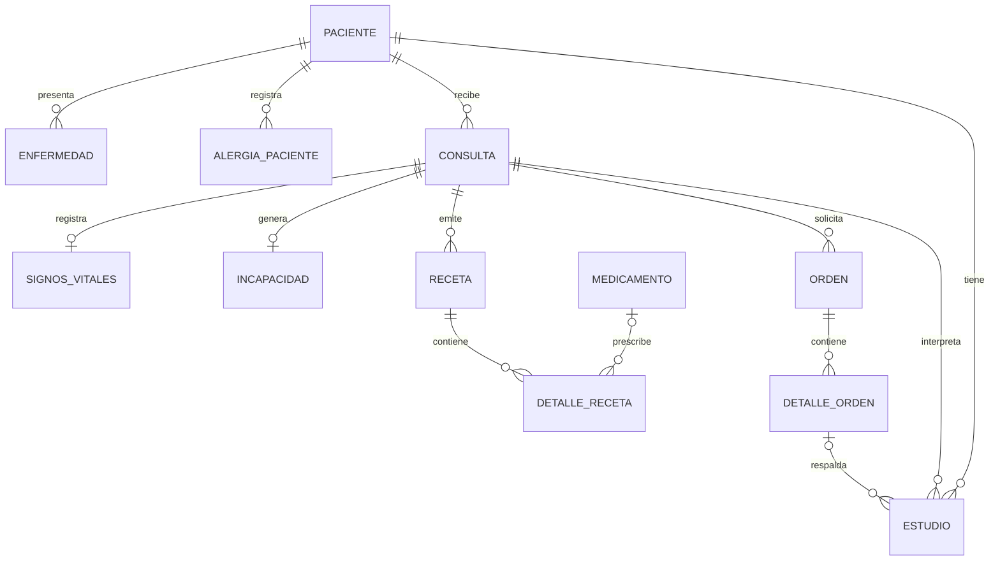

# DAS901 - APPCLINICA

Aplicación web ASP.NET Core MVC para gestionar pacientes, consultas, triaje,
recetas, órdenes de examen, resultados de estudios, alergias, enfermedades e
incapacidades. La información clínica se persiste en SQL Server mediante
Entity Framework Core; las credenciales de usuario de desarrollo se conservan
en `App_Data/users.json`.

## Requisitos

- .NET SDK 10
- SQL Server accesible desde la aplicación
- Herramienta EF Core CLI para crear migraciones: `dotnet tool install --global dotnet-ef --version 10.0.14`

## Configuración y ejecución

1. Configura `ConnectionStrings:DefaultConnection` en `appsettings.json` o en
   `appsettings.Development.json`. No guardes credenciales reales en archivos
   versionados; usa secretos de usuario o variables de entorno para ellas.
2. Ejecuta la aplicación:

   ```bash
   dotnet run
   ```

   Al iniciar, la aplicación aplica las migraciones EF Core y prepara el esquema
   de la base de datos. También intenta importar `App_Data/clinic-data.json`
   una sola vez si la base de datos aún no contiene pacientes. El archivo JSON
   original no se elimina.
3. Para aplicar las migraciones manualmente antes de iniciar la app:

   ```bash
   dotnet ef database update
   ```

Si la base ya contiene pacientes y el JSON legado también contiene datos, la
importación se detiene con un error explícito para evitar duplicados. Conserva
una copia de seguridad de `App_Data/clinic-data.json` antes de la primera
ejecución con SQL Server.

## Persistencia y arquitectura

Los controladores MVC dependen de contratos (`IClinicDataStore`,
`IPacienteService` e `IMedicamentoService`) registrados por inyección de
dependencias. Los servicios aplican reglas de negocio y usan repositorios para
consultar y modificar entidades; `IUnitOfWork` concentra la confirmación de los
cambios de los CRUD de pacientes y medicamentos. `EfRepository<TEntity>`
comparte las operaciones básicas, mientras que los repositorios especializados
contienen consultas propias de pacientes, alergias, enfermedades y
medicamentos. El contexto SQL Server es scoped por solicitud. Las consultas de
análisis están aisladas en `IConsultationAnalysisService` y
`ConsultationAnalysisService`.

La eliminación de pacientes está restringida a expedientes sin alergias,
enfermedades, consultas ni estudios, para no borrar el historial clínico.
Los medicamentos con recetas asociadas no se pueden eliminar. Pacientes,
alergias, enfermedades y medicamentos cuentan con operaciones de creación,
consulta, actualización y eliminación protegida según sus relaciones. Las
recetas, detalles de órdenes, estudios e incapacidades también tienen
operaciones de actualización o eliminación donde corresponde.

### Diagrama entidad-relación



La configuración detallada de claves, relaciones, restricciones y datos
iniciales está en `Data/ClinicaDbContext.cs`; el esquema versionado se encuentra
en `Migrations/`.

## Diccionario de datos (resumen)

| Entidad / tabla | Atributos principales | Relaciones |
|---|---|---|
| `Paciente` / `pacientes` | Id, Nombre, FechaNacimiento, Dui opcional | Raíz del expediente |
| `Enfermedad` / `enfermedades` | Id, IdPaciente, Nombre, AnioDiagnostico | Pertenece a un paciente |
| `AlergiaPaciente` / `alergias_paciente` | Id, IdPaciente, TipoAlergia, SustanciaElemento, Severidad | Pertenece a un paciente |
| `Consulta` / `consultas` | Id, IdPaciente, fechas, Motivo, ExamenFisico, Diagnostico, Prioridad, Estado | Pertenece a un paciente |
| `SignosVitales` / `signos_vitales` | Id, IdConsulta, Peso, Altura, Temperatura, presiones y mediciones adicionales | Uno por consulta |
| `Incapacidad` / `incapacidades` | Id, IdConsulta, FechaInicio, FechaFin, Motivo | Opcional por consulta |
| `Receta` / `receta` | Id, IdConsulta | Una consulta puede emitir recetas |
| `DetalleReceta` / `detalle_receta` | Id, IdReceta, IdMedicamento opcional, Dosis, Frecuencia, Duracion, Indicaciones | Une receta y medicamento |
| `Medicamento` / `medicamentos` | Id, Nombre | Catálogo usado por detalles de receta |
| `Orden` / `ordenes` | Id, ConsultaId, FechaHoraEmision | Pertenece a una consulta |
| `DetalleOrden` / `detalle_orden` | Id, IdOrden, Nombre, Indicaciones | Pertenece a una orden |
| `Estudio` / `estudios` | Id, IdPaciente, IdDetalleOrden opcional, IdConsultaLectura, Nombre, Observaciones, Fecha | Vincula paciente, consulta lectora y orden opcional |

Las claves primarias son `Id` (excepto el marcador de importación, cuya clave es
`Name`). Las claves foráneas y reglas de borrado se configuran en
`ClinicaDbContext`. Los medicamentos iniciales se cargan mediante datos semilla.

## Consultas LINQ

El módulo `/Analisis` permite filtrar consultas por rango de fechas, estado y
prioridad; ordenarlas y paginarlas; agruparlas por estado y día; obtener
diagnósticos y medicamentos frecuentes; y calcular la duración promedio. Las
lecturas usan `AsNoTracking`, proyecciones y operaciones traducibles a SQL
Server.

## Organización del proyecto

- `Controllers/`: controladores MVC y validación HTTP.
- `Data/`: contexto de EF Core y marcador de importación de datos.
- `Models/`: entidades y enumeraciones del dominio.
- `Repositories/`: repositorio EF genérico y repositorios especializados por entidad.
- `Services/`: contratos y reglas de negocio, flujos clínicos, importación legado y análisis LINQ.
- `ViewModels/`: modelos de entrada y presentación.
- `Views/`: interfaz MVC.
- `Migrations/`: cambios versionados del esquema SQL Server.

## Verificación

Compila el proyecto con:

```bash
dotnet build
```

Para validar la persistencia en ejecución, inicia la aplicación contra una
instancia SQL Server disponible, registra un paciente y verifica que el
expediente y las operaciones de consulta aparezcan después de reiniciar la app.
