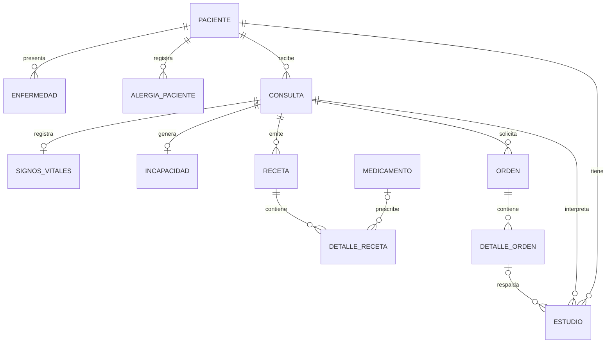

# DAS901 - APPCLINICA

Aplicación web ASP.NET Core MVC para gestionar pacientes, consultas, triaje,
recetas, órdenes de examen, resultados de estudios, alergias, enfermedades e
incapacidades. La información clínica se persiste en SQL Server mediante
Entity Framework Core; las credenciales de usuario de desarrollo se conservan
en `App_Data/users.json`.

## Requisitos

- .NET SDK 10
- SQL Server accesible desde la aplicación
- Herramienta EF Core CLI para crear migraciones: `dotnet tool install --global dotnet-ef --version 10.0.14`

## Configuración y ejecución

1. Configura la cadena `ConnectionStrings:DefaultConnection` mediante secretos
   de usuario o la variable de entorno `ConnectionStrings__DefaultConnection`.
   No guardes credenciales reales en archivos versionados.
2. En un entorno de desarrollo sin `App_Data/users.json`, configura las cuentas
   iniciales con User Secrets (nombres y correos de prueba propios):

   ```powershell
   dotnet user-secrets init --project .\ClinicaApp.csproj
   dotnet user-secrets set "DevelopmentSeedUsers:0:Name" "Nombre de doctora" --project .\ClinicaApp.csproj
   dotnet user-secrets set "DevelopmentSeedUsers:0:Email" "doctora@example.test" --project .\ClinicaApp.csproj
   dotnet user-secrets set "DevelopmentSeedUsers:0:Password" "<contraseña segura>" --project .\ClinicaApp.csproj
   dotnet user-secrets set "DevelopmentSeedUsers:0:Role" "Doctora" --project .\ClinicaApp.csproj
   ```

   Repite los comandos con índice `1` y rol `Secretaria` si necesitas esa
   cuenta. No uses contraseñas de ejemplo. Los usuarios se guardan en
   `App_Data/users.json` con hash de contraseña; ese archivo y los datos clínicos
   locales están excluidos de Git.
3. Ejecuta la aplicación:

   ```bash
   dotnet run
   ```

   Al iniciar, la aplicación aplica las migraciones EF Core y prepara el esquema
   de la base de datos. También intenta importar `App_Data/clinic-data.json`
   una sola vez si la base de datos aún no contiene pacientes. El archivo JSON
   original no se elimina.
4. Para aplicar las migraciones manualmente antes de iniciar la app:

   ```bash
   dotnet ef database update
   ```

Si la base ya contiene pacientes y el JSON legado también contiene datos, la
importación se detiene con un error explícito para evitar duplicados. Conserva
una copia de seguridad de `App_Data/clinic-data.json` antes de la primera
ejecución con SQL Server.

## Autenticación, API y seguridad

- El acceso web existente conserva autenticación por cookie, roles `Doctora` y
  `Secretaria`, contraseñas protegidas con `PasswordHasher<T>` y validación de
  rol en cada solicitud. Las operaciones de formulario POST usan antiforgery.
- `POST /api/auth/token` valida las mismas credenciales y emite un JWT firmado
  con vigencia de 30 minutos. En desarrollo la clave se genera temporalmente al
  iniciar; en producción es obligatorio proporcionar `Jwt__SigningKey` mediante
  un almacén de secretos o variable de entorno. Usa una clave aleatoria
  criptográficamente segura de al menos 32 bytes.
  `Jwt__Issuer` y `Jwt__Audience` son opcionales (por defecto `ClinicaApp`).
- Las lecturas API aceptan cookie o Bearer para conservar la búsqueda actual.
  Las operaciones API que modifican datos requieren JWT Bearer, evitando que
  una cookie del navegador autorice escrituras sin protección CSRF. Las vistas
  MVC mantienen sus tokens antiforgery.
- Swagger está disponible en `/swagger`; usa **Authorize** y pega el token sin
  anteponer `Bearer`. Los DTO validan entradas en servidor. La vista de búsqueda
  también usa Fetch para actualizar resultados sin recargar; los textos de
  respuesta se agregan como texto, no como HTML.
- Los errores API no controlados se registran en el servidor y devuelven un
  `ProblemDetails` genérico sin filtrar detalles internos. Las solicitudes con
  credenciales inválidas generan un evento de advertencia sin registrar la
  contraseña.

La autenticación conserva deliberadamente el almacenamiento JSON y el flujo web
actual para no migrar cuentas ni alterar la aplicación. Usa el hasher de ASP.NET
Core Identity, pero no migra a `UserManager`/`IdentityDbContext`; esa migración
requeriría un cambio de almacenamiento y datos separado.

Para probar la API, inicia la app y abre [ClinicaApp.http](./ClinicaApp.http)
desde VS Code (REST Client) o prueba los endpoints en Swagger. El archivo
contiene solicitudes para obtener un token y usarlo con la API.

## Persistencia y arquitectura

Los controladores MVC dependen de contratos (`IClinicDataStore`,
`IPacienteService` e `IMedicamentoService`) registrados por inyección de
dependencias. Los servicios aplican reglas de negocio y usan repositorios para
consultar y modificar entidades; `IUnitOfWork` concentra la confirmación de los
cambios de los CRUD de pacientes y medicamentos. `EfRepository<TEntity>`
comparte las operaciones básicas, mientras que los repositorios especializados
contienen consultas propias de pacientes, alergias, enfermedades y
medicamentos. El contexto SQL Server es scoped por solicitud. Las consultas de
análisis están aisladas en `IConsultationAnalysisService` y
`ConsultationAnalysisService`.

La eliminación de pacientes está restringida a expedientes sin alergias,
enfermedades, consultas ni estudios, para no borrar el historial clínico.
Los medicamentos con recetas asociadas no se pueden eliminar. Pacientes,
alergias, enfermedades y medicamentos cuentan con operaciones de creación,
consulta, actualización y eliminación protegida según sus relaciones. Las
recetas, detalles de órdenes, estudios e incapacidades también tienen
operaciones de actualización o eliminación donde corresponde.

### Diagrama entidad-relación



La configuración detallada de claves, relaciones, restricciones y datos
iniciales está en `Data/ClinicaDbContext.cs`; el esquema versionado se encuentra
en `Migrations/`.

## Diccionario de datos (resumen)

| Entidad / tabla | Atributos principales | Relaciones |
|---|---|---|
| `Paciente` / `pacientes` | Id, Nombre, FechaNacimiento, Dui opcional | Raíz del expediente |
| `Enfermedad` / `enfermedades` | Id, IdPaciente, Nombre, AnioDiagnostico | Pertenece a un paciente |
| `AlergiaPaciente` / `alergias_paciente` | Id, IdPaciente, TipoAlergia, SustanciaElemento, Severidad | Pertenece a un paciente |
| `Consulta` / `consultas` | Id, IdPaciente, fechas, Motivo, ExamenFisico, Diagnostico, Prioridad, Estado | Pertenece a un paciente |
| `SignosVitales` / `signos_vitales` | Id, IdConsulta, Peso, Altura, Temperatura, presiones y mediciones adicionales | Uno por consulta |
| `Incapacidad` / `incapacidades` | Id, IdConsulta, FechaInicio, FechaFin, Motivo | Opcional por consulta |
| `Receta` / `receta` | Id, IdConsulta | Una consulta puede emitir recetas |
| `DetalleReceta` / `detalle_receta` | Id, IdReceta, IdMedicamento opcional, Dosis, Frecuencia, Duracion, Indicaciones | Une receta y medicamento |
| `Medicamento` / `medicamentos` | Id, Nombre | Catálogo usado por detalles de receta |
| `Orden` / `ordenes` | Id, ConsultaId, FechaHoraEmision | Pertenece a una consulta |
| `DetalleOrden` / `detalle_orden` | Id, IdOrden, Nombre, Indicaciones | Pertenece a una orden |
| `Estudio` / `estudios` | Id, IdPaciente, IdDetalleOrden opcional, IdConsultaLectura, Nombre, Observaciones, Fecha | Vincula paciente, consulta lectora y orden opcional |

Las claves primarias son `Id` (excepto el marcador de importación, cuya clave es
`Name`). Las claves foráneas y reglas de borrado se configuran en
`ClinicaDbContext`. Los medicamentos iniciales se cargan mediante datos semilla.

## Consultas LINQ

El módulo `/Analisis` permite filtrar consultas por rango de fechas, estado y
prioridad; ordenarlas y paginarlas; agruparlas por estado y día; obtener
diagnósticos y medicamentos frecuentes; y calcular la duración promedio. Las
lecturas usan `AsNoTracking`, proyecciones y operaciones traducibles a SQL
Server.

## Organización del proyecto

- `Controllers/`: controladores MVC y validación HTTP.
- `Data/`: contexto de EF Core y marcador de importación de datos.
- `Models/`: entidades y enumeraciones del dominio.
- `Repositories/`: repositorio EF genérico y repositorios especializados por entidad.
- `Services/`: contratos y reglas de negocio, flujos clínicos, importación legado y análisis LINQ.
- `ViewModels/`: modelos de entrada y presentación.
- `Views/`: interfaz MVC.
- `Migrations/`: cambios versionados del esquema SQL Server.

## Manual breve de uso

1. Inicia sesión con una cuenta habilitada de doctora o secretaria.
2. En **Pacientes**, busca por nombre o DUI. La búsqueda actualiza resultados
   de forma asíncrona; sin JavaScript, el formulario conserva la búsqueda
   tradicional.
3. La secretaria puede registrar/editar expedientes y registrar la llegada a
   sala de espera. También puede guardar triaje y prioridad.
4. La doctora puede revisar el expediente, atender consultas, registrar
   alergias/enfermedades y emitir recetas, órdenes, estudios e incapacidades.
5. Cierra sesión desde la navegación. No compartas cuentas ni tokens; el token
   JWT debe tratarse como una contraseña temporal.

## Publicación en IIS

1. Instala el **.NET 10 Hosting Bundle** en Windows Server, crea un sitio IIS y
   usa un Application Pool con **No Managed Code**.
2. Publica el proyecto:

   ```powershell
   dotnet publish .\ClinicaApp.csproj --configuration Release --output .\publish
   ```

3. Copia el contenido publicado al sitio. El `web.config` del proyecto configura
   el módulo ASP.NET Core e inicia en `Production`; configura HTTPS en IIS.
4. Define `ConnectionStrings__DefaultConnection` y `Jwt__SigningKey` en el
   entorno del proceso o en un almacén de secretos seguro. No pongas esos
   valores en `web.config` ni en archivos versionados.
   Para generar una clave aleatoria localmente en PowerShell:

   ```powershell
   [Convert]::ToBase64String([Security.Cryptography.RandomNumberGenerator]::GetBytes(32))
   ```

5. Prepara `App_Data/users.json` de forma segura antes del primer inicio: crea
   cuentas iniciales en un entorno Development usando User Secrets y transfiere
   el archivo generado por un canal seguro. El archivo contiene hashes, no
   contraseñas; nunca lo agregues al repositorio.
6. Concede a la identidad del Application Pool solo los permisos necesarios:
   lectura/ejecución del sitio, escritura en `App_Data` para las cuentas locales
   y permisos mínimos en SQL Server. Restringe el acceso directo a `App_Data`.
7. Verifica inicio de sesión, acceso por roles, `/swagger`, emisión de JWT,
   operaciones API permitidas/denegadas y persistencia de datos. Revisa los
   logs del host y configura copias de seguridad de SQL Server.

Para Azure App Service, publica el mismo artefacto y configura la cadena de
conexión y la clave JWT como **Application settings**; habilita HTTPS y usa
Azure SQL con identidad administrada cuando esté disponible. La publicación
real requiere recursos y credenciales del entorno de destino.

## Entrega y comprobación final

- Ejecuta `dotnet build` y las pruebas manuales descritas en `ClinicaApp.http`.
- Antes de entregar, valida todos los roles y flujos en un entorno limpio con
  base de datos configurada; no uses información clínica real en la demo.
- Para la presentación, graba un recorrido breve de inicio de sesión, búsqueda
  asíncrona, registro/consulta clínica, Swagger con Bearer y despliegue. Incluye
  capturas de resultados y conserva el video como evidencia del equipo.
- Registra el trabajo en el repositorio del equipo con commits descriptivos. Este
  directorio debe estar inicializado/vinculado al repositorio remoto del curso
  para poder generar historial y evidencia de Git.

## Verificación

Compila el proyecto con:

```bash
dotnet build
```

Para validar la persistencia en ejecución, inicia la aplicación contra una
instancia SQL Server disponible, registra un paciente y verifica que el
expediente y las operaciones de consulta aparezcan después de reiniciar la app.
